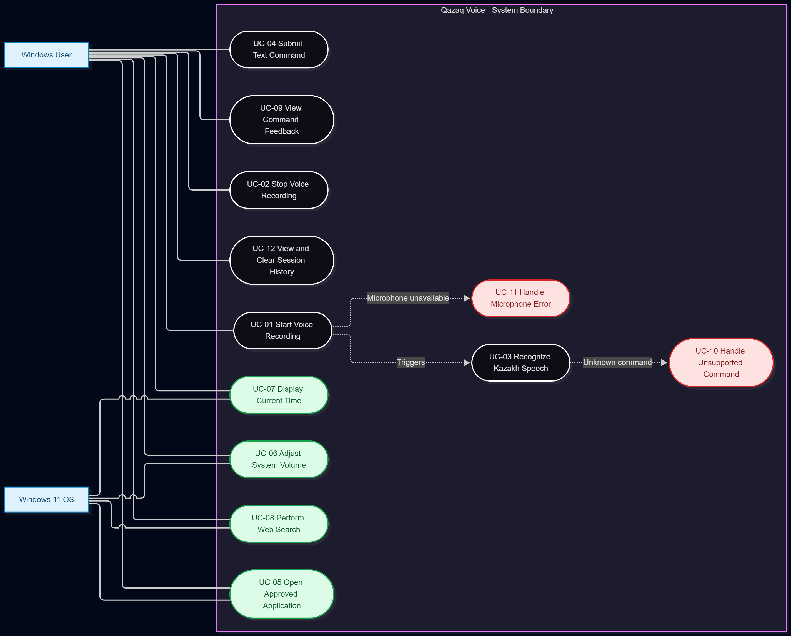
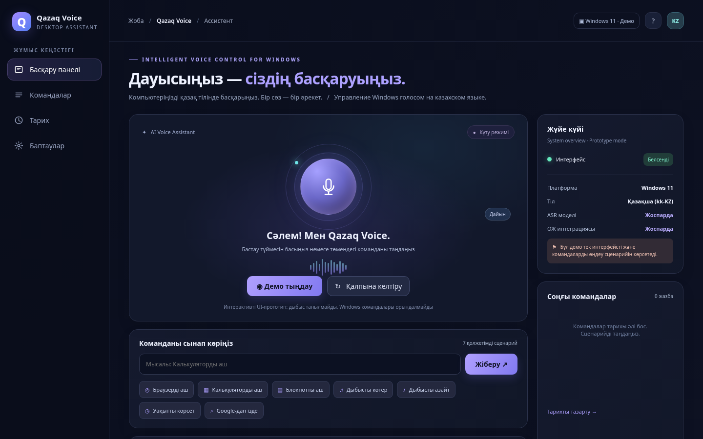

{width=2.75in}

# ASTANA IT UNIVERSITY

**SCHOOL OF SOFTWARE ENGINEERING**

**DIPLOMA PROJECT — FIRST CHECKPOINT REPORT**

## Development of an Intelligent Voice Control System in the Kazakh Language Based on Neural Networks

**QAZAQ VOICE**

**Team Members:** Temirgali Nurislam Kairatuly; Myrzatay Alan Abayuly; Abdigali Nurassyl Zhandosuly

**Group:** SE-2413

**Scientific Supervisor:** Turarova Marzhan Kabdikalievna

**Date of Submission:** 24 October 2026

**Astana, Kazakhstan**

\newpage

# Table of Contents

1. Project Proposal and Scope
2. Evidence of Project Relevance and User Needs
3. Critical Literature Review
4. Comparison of Existing Voice-Control Systems
5. Technology Alternatives and Technical Decisions
6. Software Requirements Specification
7. System Architecture and Diagrams
8. UX Prototype and Interaction Scenarios
9. Verification and Evaluation Plan
10. Project Management and Risk Analysis
11. Supervisor Feedback and Consultation Record
12. Consolidated References
13. Appendices and Evidence Inventory

\newpage

# Executive Summary

Qazaq Voice is a proposed **Windows 11 desktop voice assistant** designed to recognize spoken Kazakh, map recognized speech to a restricted set of user intents, validate actions, and safely execute selected operating-system functions. The first checkpoint documents the problem, preliminary user research, scientific literature, competing systems, technology choices, software requirements, system architecture, UX prototype, evaluation methodology, management plan, and reported supervisor consultation.

**Implementation boundary:** The existing HTML/CSS/JavaScript application is an interactive **UX simulation**. It does not perform microphone capture, neural ASR inference, or actual Windows command execution. Performance figures in this report are **proposed targets**, not experimental results.

**Evidence base:** Six anonymous questionnaire submissions collected on 20–23 October 2026; twelve scientific publications directly discussed in the literature review; and a consolidated set of **23 references**, including official product and technology documentation. The questionnaire does not independently establish six distinct identities, and is not represented as a set of interviews.

**Contribution:** The project aims to connect Kazakh speech recognition with **measurably reliable, allowlisted Windows 11 command execution**. It does not claim to be the first Kazakh-language voice assistant.


# 1. Project Proposal and Scope


## Problem statement

Windows voice interaction is a practical mode of computer use, yet availability of **Kazakh-language OS-level command workflows** should be carefully evaluated rather than assumed. Microsoft lists supported Windows Voice Access languages in its documentation; Kazakh is not in that published list as checked for this draft [R1]. The existence of Kazakh speech corpora [R2, R3] and research on multilingual Turkic speech recognition [R4] does not guarantee a reliable Kazakh desktop command interface. The project investigates that missing link.


## Intended users and value

Primary: Kazakh-speaking Windows users who want hands-free control. Secondary **candidate groups**: older adults and people with mobility/access needs. Improved accessibility is a **design hypothesis**; it has not yet been shown in a user study. Different disabilities imply different accessibility requirements. A voice-only interface must retain non-voice fallback.


## Aim

Design, implement in later stages, and evaluate a **Windows 11 desktop assistant** that converts spoken Kazakh into recognized intents and executes **only a constrained allowlist** of safe OS actions with feedback and recoverable errors.


## Objectives

1. Validate relevance and target user needs with 3–5 real consultations or real-client agreement.
2. Analyze at least 12 sources and existing systems; compare ASR, desktop UI, and Windows integration choices.
3. Specify testable functional and nonfunctional requirements.
4. Design system context, use case, and component architecture with an explicit Windows security boundary.
5. Build a static/interactable desktop UI **mock** for voice-control flows.
6. Later integrate Kazakh ASR, intent detection, and Windows execution; evaluate WER/CER, task success, latency and safety.


## Scope of first MVP (planned, not implemented)

- Start/stop microphone recording; transcribe Kazakh speech; show transcript and confidence/uncertainty feedback.
- Match safe intents: `open_browser`, `open_calculator`, `open_notepad`, `volume_up`, `volume_down`, `show_time`, `web_search` (with validated query).
- Confirm sensitive actions where appropriate; refuse unsupported speech and do not pass recognized text to shells.
- Record minimal non-sensitive diagnostic data only with defined retention policy.

**Exclusions:** arbitrary terminal execution; deletion/shutdown/restart commands; financial operations; always-on microphone; smart-home hardware; guarantees of full accessibility. Offline local ASR is a candidate, not yet confirmed.


## October checkpoint boundary

This stage requires **research, requirements, design, prototype, evaluation plan, supervisor input, and verifiable contributions**, **not a complete working assistant**. The prepared HTML desktop-style mockup is an interactive design demonstration; it does not perform voice recognition or Windows actions.


## Open decisions

Final ASR model, target hardware, approved commands and quantitative goals require evidence-based review with the supervisor.


# 2. Evidence of Project Relevance and User Needs

## Evidence and Method

The initial rationale combines Kazakh ASR research [R2–R4], Microsoft's published Windows Voice Access language list [R1], and primary user feedback. Kazakh speech data and multilingual models are available, but neither existence of corpora nor the absence of Kazakh from a particular product's documented language list alone proves user demand or functional feasibility. To gather preliminary needs, the team used an **anonymous Microsoft Forms questionnaire** with seven substantive questions and one consent question. The collection period was **20–23 October 2026**.

The source export `Users_answers.xlsx` contains **six submissions (P01–P06)**, with consent indicated in each. Four respondents reported using Windows daily; one several times per week; one rarely. Three reported fluent Kazakh, one conversational, one basic, and one no Kazakh. Five had experience with a voice assistant such as Siri or Alice. No submission explicitly reported using an assistant in Kazakh. The export does not independently confirm unique identities.

## Findings and Design Implications

| Observation from questionnaire | Project implication |
|---|---|
| P01 and P03 requested browser/app launching | Include three approved app-launch intents |
| P02, P03 and P04 raised volume control | Include bounded `volume_up` and `volume_down` |
| Five of six wanted manual or visual alternatives | Provide text input, visible feedback and recovery |
| P01 reported regional pronunciation concerns | Include accent variation in future evaluation |
| P05 mentioned Kazakh–Russian language mixing | Plan code-switching cases in ASR tests |
| P04 identified microphone problems | Show recording state and recoverable errors |
| P02 suggested email composition | Record as future scope, not first MVP |

The strongest directly expressed needs concern **launching applications** and **adjusting audio volume**. Other MVP commands (current time and web search) are engineering design choices rather than individually validated high-demand features. The evidence suggests using a prominent microphone control but also preserving mouse/keyboard operation. It also suggests evaluating varied speech conditions, without making any claim about actual recognition accuracy.

## Study Limitations

The sample is small, anonymous, self-selected and nonrepresentative. One respondent does not speak Kazakh; their usability preferences are supplementary rather than direct evidence of demand for Kazakh speech interaction. The data documents a **questionnaire, not separately verified stakeholder interviews**. Recruitment, distinct respondent identity, age/disability status and test performance are not established by the export. Thus the findings inform initial requirements and UX design only; they do not demonstrate accessible operation, adoption, or success rates. Original response data should be kept separate from the public repository and shared only as appropriate for academic review.

## Result

Preliminary preferences were incorporated into KVC-6 (FR-05, FR-06, FR-08), KVC-8 (manual fallback and errors), and KVC-9 (linguistic, noise and microphone tests). A larger, appropriately consented study and actual usability testing remain future work.

## Individual Participant Findings
The following table summarizes the submitted answers. These are **researcher paraphrases**, not verbatim quotations.

| ID | Main findings | Potential design implications |
|---|---|---|
| P01 | Uses Windows daily and Siri in Russian or English. Wants basic commands such as opening applications or a browser. Raised concerns about regional Kazakh speech differences and wants manual correction options. | Support application-launch commands, investigate regional pronunciation variation, and provide visible feedback. |
| P02 | Uses Windows rarely and has no previous voice-assistant experience. Suggested controlling video volume and composing emails by speech. Expressed concern that the interface might be difficult to understand because of age-related familiarity issues. | Use a simple interface, include volume commands, and consider speech-to-text email composition as a future feature. |
| P03 | Uses Windows several times per week and has basic Kazakh proficiency. Has experience with Alice in Yandex Browser. Wants application-launch and volume commands. Expressed concern about recognition of less-proficient Kazakh speech and preferred voice-focused interaction. | Evaluate recognition of different speaking styles and prioritize basic voice commands. |
| P04 | Uses Windows daily and Siri in English. Suggested volume control and reported microphone problems. Preferred having visual controls when speech recognition fails. | Provide microphone-status feedback, error handling, and visible controls. |
| P05 | Uses Windows daily and Siri in Russian. Did not identify a specific priority command. Highlighted Kazakh–Russian code-switching and supported visual interface options. | Include code-switching scenarios in the future evaluation plan and preserve non-voice alternatives. |
| P06 | Uses Windows daily but does not speak Kazakh. Has experience with Alice and Siri in Russian. Suggested basic operations and preferred manual alternatives because voice assistants may misunderstand commands. | Provides supplementary evidence for safe command handling and fallback controls, but not direct Kazakh-language demand. |


# 3. Critical Literature Review

The review examines **12 scientific publications**, of which ten date from 2021–2023 and two are foundational 2020 studies. The complete eight-column research matrix, evidence notes and links are retained in `docs/literature_matrix.xlsx`. Product pages used in KVC-4 are not counted as scientific papers.

## Scientific Evidence Matrix

| Ref. and study | Contribution to project | Limits for Qazaq Voice |
|---|---|---|
| [R2] Khassanov et al. (2021) | 332-hour Kazakh speech corpus and baseline | Not designed for desktop commands |
| [R3] Mussakhojayeva et al. (2022), KSC2 | Industrial-scale Kazakh corpus, over 1,000 hours | Domain shift and noise remain unmeasured |
| [R4] Mussakhojayeva et al. (2023) | Multilingual ASR approaches for Turkic languages | Published gains cannot be transferred untested |
| [R5] Radford et al. (2023), Whisper | Large-scale weakly supervised multilingual ASR | Kazakh command WER and latency unknown |
| [R6] Babu et al. (2022), XLS-R | Self-supervised cross-lingual speech representations | Requires appropriate fine-tuned checkpoint |
| [R7] Conneau et al. (2022), FLEURS | Multilingual speech evaluation protocol | Read-aloud data differs from spontaneous commands |
| [R8] Rekesh et al. (2023), Fast Conformer | Efficient encoder architecture | Not benchmarked here on Kazakh OS instructions |
| [R9] Mussakhojayeva et al. (2022), KazakhTTS2 | Kazakh speech synthesis resource | TTS is not speech recognition |
| [R10] Yeshpanov et al. (2023) | Multilingual Turkic TTS approach | Secondary to the MVP's ASR-to-action pipeline |
| [R11] Baevski et al. (2020), wav2vec 2.0 | Foundational self-supervised ASR method | Background architecture, not recent deployment data |
| [R12] Gulati et al. (2020), Conformer | Attention/convolution speech architecture | Original benchmarks from other conditions |
| [R13] Barrault et al. (2023), SeamlessM4T | Multilingual speech and translation pipeline | Translation system is not Windows action evaluation |

## Synthesis and Research Gap

KSC and KSC2 [R2, R3] provide evidence that Kazakh ASR models can be investigated using accessible corpora. Multilingual modeling [R4–R6] and efficient encoders [R8, R11, R12] offer candidate approaches, but **recognition of short Kazakh desktop instructions** requires its own held-out test set. FLEURS [R7] informs evaluation design, while speech generation and translation work [R9, R10, R13] is secondary to the seven-intent MVP.

The core engineering problem is not speech recognition in isolation. The proposed contribution is **Kazakh speech → intent classification → validation → bounded Windows action**, with observable feedback and reproducible evaluation of WER/CER, intent accuracy, task success, latency and unintended-action rate. None of the reviewed publications provides an experimental result for the complete Qazaq Voice system. All such performance results remain unmeasured.

## Evidence synthesis
**Kazakh data.** KSC [R2] and KSC2 [R3] provide substantial transcribed Kazakh speech, including some Kazakh–Russian code-switching in KSC2. Both help define a possible ASR training and evaluation pathway; domain shift to short desktop commands and noisy rooms must be measured separately.

**Transfer across Turkic languages.** [R4] presents multilingual ASR work across Turkic languages. Transfer can help lower-resourced speech recognition, but these research outcomes cannot automatically be treated as expected command accuracy in our Windows application.

**Model families.** Whisper [R5] demonstrates large-scale weak supervision and multilingual generalization. XLS-R [R6] offers cross-lingual self-supervised representations. Fast Conformer [R8] explores more efficient ASR encoders. wav2vec 2.0 [R11] and Conformer [R12] are older conceptual foundations. Our stack decision requires a Kazakh command benchmark rather than selecting a model by its published benchmark scores alone.

**Benchmarks and adjacent capabilities.** FLEURS [R7] suggests multilingual evaluation practices, but its read-aloud speech may not represent spontaneous command speech. KazakhTTS2 [R9], multilingual Turkic TTS [R10], and SeamlessM4T [R13] concern related speech synthesis and multilingual systems. They are informative for possible future interaction features but cannot substitute for direct evidence about Kazakh ASR command recognition.


## Selection rationale
Core topic-specific evidence prioritizes research published between 2021 and 2023. Two papers from 2020 are retained as foundational references because they introduce important ASR architectures and self-supervised learning methods.

The 12 publications were selected to cover:

1. Kazakh-language speech datasets.
2. Multilingual ASR for Turkic languages.
3. Neural speech recognition architectures.
4. Multilingual speech evaluation methodology.
5. Adjacent speech synthesis and translation technologies.

The literature review distinguishes **reported findings from previous publications** from the team's proposed technical decisions.

No performance results from these publications are presented as original measurements conducted by the project team.


# 4. Comparison of Existing Voice-Control Systems


## Purpose and Scope

This section compares **five existing voice interaction products** with the planned Qazaq Voice system: Microsoft Windows Voice Access, VoiceAttack, Talon Voice, Apple Siri, and Yandex Alice. The objective is to establish which capabilities are already documented and identify a defensible project focus.

**Project scope:** Qazaq Voice is a proposed Windows 11 desktop application that recognizes Kazakh commands, maps them to a restricted set of intents, validates actions, and provides clear execution feedback. The current checkpoint does **not** contain a working neural ASR or Windows executor.

The comparison uses published official product documentation; it does not claim hands-on testing or exhaustive product feature coverage. "Not established" means the cited documentation does not substantiate a capability; it must not be interpreted as a proven absence of that capability.


## Systems Examined

### Microsoft Windows Voice Access

Windows Voice Access enables voice-based PC interaction, app control, and dictation on supported Windows 11 versions [R1]. Microsoft's published supported-language list does **not include Kazakh** (accessed 23 October 2026). Microsoft also documents user-defined voice shortcuts [R18]. This makes Voice Access the closest operating-system-level reference for interaction design, but not a verified baseline for Kazakh speech-to-action commands.

### VoiceAttack

VoiceAttack is a Windows voice-command application focused on custom commands, app launching, and macros. Its official website documents application launching, keyboard/mouse automation, and customizable commands [R14]. The reviewed public product page does not establish official Kazakh recognition support. Therefore, Kazakh support is recorded as **unverified**, not categorically unsupported.

### Talon Voice

Talon targets extensive desktop control and accessibility, with Windows support, scripting, and speech-recognition integration [R15]. The reviewed documentation describes programmable commands and hands-free workflows, but it does not establish an officially supported Kazakh ASR model. Its modularity is relevant to Qazaq Voice's architecture, while its intended workflow and language coverage are not assumed to be identical.

### Apple Siri

Siri is Apple's voice assistant for the Apple device ecosystem. Official Apple documentation describes device-specific availability, settings, and functionality [R16]. The cited source does not establish either Windows desktop OS control or Kazakh-language speech recognition. The comparison therefore does not label Siri as a Kazakh Windows-control solution.

### Yandex Alice

Yandex states that Alice can communicate in **Kazakh or Russian** in its basic mode [R17]. Consequently, the Qazaq Voice proposal must **not** claim to be the first Kazakh-language voice assistant. The differentiation under investigation is narrower: a measurable Kazakh speech-to-action workflow designed specifically for a controlled set of Windows 11 desktop functions. Support for arbitrary Windows OS actions in Kazakh is not established by the cited Alice FAQ.


## Comparative Findings


| System | Documented capability | Main limitation for the proposed Kazakh-to-Windows workflow |
|---|---|---|
| Windows Voice Access [R1, R18] | Windows 11 OS control, dictation, voice shortcuts | Kazakh not in the published supported-language list consulted |
| VoiceAttack [R14] | User-defined Windows app commands and macros | Official Kazakh recognition support not established by reviewed page |
| Talon Voice [R15] | Scriptable, hands-free desktop operation | Kazakh ASR support not established by reviewed documentation |
| Siri [R16] | Voice assistance in the Apple device ecosystem | Not a documented Kazakh Windows OS control system |
| Yandex Alice [R17] | Kazakh and Russian voice assistance | Kazakh control of arbitrary Windows actions not established by cited FAQ |


## Critical Discussion

### Closest Functional Reference

Windows Voice Access is the most direct comparison for desktop operating-system commands. Its documented interface demonstrates the relevance of hands-free Windows navigation, command feedback, and language-dependent availability [R1, R18]. Qazaq Voice should not duplicate the entire Windows Voice Access command set; it proposes a smaller, explicitly allowlisted Kazakh command vocabulary.

### Customization and Safety

VoiceAttack and Talon demonstrate the value of customizable voice-driven desktop workflows [R14, R15]. However, flexible macros and scripts can enable actions outside Qazaq Voice's proposed safety scope. The project therefore favors **structured intents and validation** over unrestricted conversion of recognized text into shell commands.

### Kazakh Support and Novelty

Alice's officially documented Kazakh support [R17] makes language availability alone an inadequate originality claim. The proposed contribution should be evaluated through objective evidence: Kazakh speech recognition accuracy, intent correctness, real Windows command execution, error handling, and latency for a defined seven-intent vocabulary.

The comparison **does not establish** that no current product could be configured to accomplish similar tasks. It identifies a specific implementation and evaluation problem worth investigating.

### Accessibility

Voice interfaces may offer hands-free alternatives for some users, but their usability depends on pronunciation, microphones, feedback, input alternatives, and individual needs. Talon's documentation explicitly motivates desktop control for people with limited hand use [R15]. Qazaq Voice's potential accessibility benefits require subsequent user-centered evaluation and must not be presented as already verified.


## Limitations and Next Steps

This desk study uses official websites and documentation as a **preliminary comparison**. It does not include independent installation tests, user observations, measurement of recognition accuracy, systematic license review, or exhaustive verification of product language support.

Future evaluation should confirm current versions and settings, clearly distinguish different product platforms, and test Qazaq Voice using a fixed Kazakh command dataset. No comparative WER, CER, execution success rate, or latency results are claimed here.


## Implications for Qazaq Voice

| Observation | Design Implication | Related Document |
|---|---|---|
| Windows voice control is an established interaction category | Focus differentiation on Kazakh command recognition and a reproducible evaluation | KVC-1, KVC-9 |
| Official Voice Access language list excludes Kazakh | Evaluate a Kazakh-capable neural ASR baseline | KVC-5, KVC-6 |
| VoiceAttack and Talon offer powerful customization | Use explicit action allowlists and defined intent schemas | KVC-6, KVC-7 |
| Alice supports Kazakh | Avoid first-of-its-kind language claims | KVC-1, KVC-2 |
| Accessibility and error recovery matter | Provide visual feedback, text input, and robust failure states | KVC-8, KVC-9 |


# 5. Technology Alternatives and Technical Decisions

Technical decisions are provisional and must be evaluated on the target Windows 11 hardware. Five implementation areas were compared against language suitability, maintainability, latency, security, licensing and available development resources.

## Comparative Technical Decisions

| Area | Alternatives considered | Preliminary decision and reason |
|---|---|---|
| Neural ASR | Whisper [R5], adapted XLS-R [R6], NeMo/Fast Conformer [R8] | Begin with Whisper baseline; benchmark a Kazakh-adapted candidate on identical command recordings |
| Desktop UI | PySide6 [R19], WPF [R20], Tauri [R21] | Propose Python/PySide6 for integration with speech/ML libraries; validate packaging and accessibility |
| Application language | Python, C#, Go | Propose Python for ASR orchestration and prototyping; isolate Windows-specific logic |
| Intent classification | Rule-based dictionary/grammar, classical ML, LLM | Use a small auditable rule-based allowlist first; investigate ML only if tested paraphrases require it |
| Windows integration | Predefined app launches, Windows APIs [R22], UI Automation [R23] | Prefer documented, explicit Windows operations over arbitrary scripting; never execute raw transcripts |

## ASR Selection

Whisper [R5] is a convenient multilingual baseline with established model variants. XLS-R [R6] enables a fine-tuned language-specific alternative, but the exact checkpoint and license must be identified. Fast Conformer [R8] may offer efficiency advantages but requires equivalent Kazakh measurements. Selection will use the same recordings, text normalization, device setup and timing method. A published generic benchmark score is not proof of the best option for this application.

## Desktop and Execution Design

The planned PySide6 desktop application [R19] contains recording controls, transcript display, intent/result feedback, text input and session history. The current HTML/CSS/JavaScript prototype establishes UX layout only; it is not evidence that PySide6 or microphone integration is complete. WPF [R20] is attractive for native Windows integration, while Tauri [R21] offers a lightweight web-based UI; both remain documented alternatives.

The core command interface will exchange structured messages, such as an `intent_id` and validated parameters, across independent components. The executor maps an approved intent to an explicit permitted operation. Launches must use known executable targets rather than concatenating recognized text into PowerShell or CMD. Search queries are treated as data and URL-encoded. UI Automation [R23] is an extension candidate only after safety and deployment testing.

## Evaluation and Decision Status

Required technical measurements include Kazakh WER/CER, macro-F1 or per-intent accuracy, execution reliability, p50/p95 latency, memory footprint and negative safety tests. Risks include accent/code-switching performance, CPU constraints, unavailable permissions and error handling. **No final ASR model or desktop execution implementation has yet been selected through experiments.**

## Architecture Decision Records (ADR)
| ADR | Decision | Status | Rationale |
|---|---|---|---|
| ADR-01 | Develop a Windows desktop application rather than a web-only assistant | Proposed | The core project objective is direct interaction with Windows |
| ADR-02 | Use Python and PySide6 for the initial implementation | Proposed | Simplifies the planned integration of UI and Python-based ASR components |
| ADR-03 | Use a fixed command allowlist for the initial MVP | Proposed | Reduces execution risk and supports predictable behavior |
| ADR-04 | Choose the final ASR model after comparative testing | Open | No project-specific benchmark results are available yet |
| ADR-05 | Use documented Windows APIs and controlled application launching | Proposed | Supports explicit command mappings and safe error handling |

These ADRs document current engineering preferences and remain subject to supervisor review and implementation evidence.


## Planned Technical Evaluation
During implementation, the team will compare available ASR candidates using a reproducible evaluation procedure.

The evaluation report should include:

- Exact model and checkpoint identifiers.
- Model versions and dependencies.
- Hardware specifications.
- Dataset source and test-set separation.
- Number and categories of spoken commands.
- WER and CER.
- Intent recognition accuracy.
- Windows action success rate.
- Median and p95 end-to-end latency.
- Memory usage and deployment size.
- Error cases and safety test results.

The team should use comparable conditions when evaluating alternative solutions.

**No numerical performance ranking is claimed at this checkpoint because the required experimental results have not yet been collected.**


# 6. Software Requirements Specification

The planned application targets **Windows 11 x64** and separates speech recognition, intent interpretation, validation and Windows execution. Requirements use MoSCoW priorities: **M** = must have, **S** = should have, **C** = could have. No requirement is marked experimentally verified in the current checkpoint.

## Functional Requirements

| ID | Priority | Functional requirement and acceptance condition |
|---|---|---|
| FR-01 | M | Explicit start/stop microphone control with visible state and recoverable permission errors |
| FR-02 | M | Neural ASR returns Kazakh transcript or clear recognition failure |
| FR-03 | M | Show transcription, including Kazakh-specific letters |
| FR-04 | M | Classify predefined intent; unsupported speech returns `UNKNOWN` without action |
| FR-05 | M | Execute seven approved Windows intents only, after validation |
| FR-06 | M | Show listening, processing, success and error feedback based on outcome |
| FR-07 | M | Recover from missing app, ASR failure, microphone errors and invalid requests |
| FR-08 | M | Mouse/keyboard operation and typed-command fallback without microphone |
| FR-09 | S | Show and clear in-session command history, without raw audio storage |
| FR-10 | C | Offline speech recognition if a compatible model is selected |

## Approved Intent Catalogue

| Intent ID | Example (Kazakh) | Controlled output |
|---|---|---|
| `open_browser` | Браузерді аш | Launch predefined default browser |
| `open_calculator` | Калькуляторды аш | Launch Calculator |
| `open_notepad` | Блокнотты аш | Launch Notepad |
| `volume_up` | Дыбысты көтер | Apply bounded volume increase |
| `volume_down` | Дыбысты азайт | Apply bounded volume decrease |
| `show_time` | Уақытты көрсет | Display local time (read-only) |
| `web_search` | Google-дан Астананы ізде | Open URL-encoded web search query |

## Non-Functional Requirements

| ID | Priority | Planned acceptance measure |
|---|---|---|
| NFR-01 Speech quality | M | Report WER and CER on held-out Kazakh samples; threshold set after pilot |
| NFR-02 Intent correctness | M | Proposed ≥85% accuracy on agreed test set including unknown intents |
| NFR-03 Execution reliability | M | Proposed ≥95% approved action success under valid test conditions |
| NFR-04 Response speed | S | Proposed p50 ≤4 s from speech end to outcome; also report p95 |
| NFR-05 Stability | M | No unhandled crash during specified failure cases |
| NFR-06 Security | M | Reject unsupported actions; prohibit unrestricted shell execution |
| NFR-07 Privacy | M | User-controlled microphone, visible recording, no persistent raw audio by default |
| NFR-08 Usability | S | Essential keyboard operation, text fallback, readable visible feedback |
| NFR-09 Compatibility | M | Verify on documented Windows 11 64-bit environment |
| NFR-10 Modularity | M | ASR, intent, validation and executor can be tested independently |

## Security and Scope Boundaries

The allowlist is the only permitted path to Windows actions. Unknown intent identifiers, arbitrary file deletion, terminal execution, shutdown/restart and privilege escalation are out of scope. Text and ASR output are **data**, never executable instructions. Windows actions require defined validation, bounded parameter ranges and clear error handling. User-facing microphone status and typed fallback are mandatory features, not proof of accessibility compliance.

The numerical figures (85%, 95%, 4 seconds) are **provisional targets**, not completed measurements. Formal requirement approval and full functional testing remain pending.

## Requirements Validation and Approval
The requirements have been prepared using the available project scope, preliminary user feedback, comparative research, and proposed engineering architecture.

However, the following decisions require additional validation:

1. Final ASR model and checkpoint.
2. Target deployment hardware.
3. Numerical ASR accuracy thresholds.
4. Final accepted command phrases and linguistic variants.
5. Performance and execution reliability targets.
6. Privacy and audio retention policy.
7. Supervisor approval of the requirement priorities and scope.

Requirements may be updated as implementation and evaluation provide new evidence.


## Required User Scenarios

### Scenario 1 — Open Calculator

**Precondition:** The application is running and microphone access is permitted.

1. The user activates the microphone.
2. The user says "Калькуляторды аш".
3. The ASR component returns the recognized phrase.
4. The intent recognition component identifies `open_calculator`.
5. The command validator approves the intent.
6. The Windows executor attempts to open Calculator.
7. The UI reports the observed result.

**Expected outcome:** Calculator opens successfully, or a recoverable error is displayed.

### Scenario 2 — Increase System Volume

1. The user says "Дыбысты көтер".
2. The system recognizes `volume_up`.
3. The action is validated.
4. The system increases the output volume by a predefined amount.
5. The UI confirms the result.

**Expected outcome:** Volume increases without exceeding the allowed range.

### Scenario 3 — Display Current Time

1. The user says "Уақытты көрсет".
2. The system identifies `show_time`.
3. The application reads the current Windows system time.
4. The time is displayed.

**Expected outcome:** The interface shows the local time without modifying system settings.

### Scenario 4 — Unsupported Command

1. The user speaks a phrase that is not part of the approved command list.
2. The system classifies the input as `UNKNOWN`.
3. No Windows action is executed.
4. The interface displays an unsupported-command message.

**Expected outcome:** Safe rejection and continued application usability.

### Scenario 5 — Microphone Access Denied

1. The user attempts to activate the microphone.
2. Windows denies access.
3. The application detects the error.
4. The UI displays a meaningful explanation.
5. The user can continue using available non-voice controls.

**Expected outcome:** The application does not crash.

### Scenario 6 — Text-Based Command Fallback

1. The user opens the desktop interface.
2. The user enters "Блокнотты аш" through a text input.
3. The system processes the phrase through the same intent validation pipeline.
4. The approved Notepad action is attempted.
5. The interface reports the result.

**Expected outcome:** The command can be executed without microphone input while preserving the same security restrictions.


# 7. System Architecture and Diagrams

The proposed Windows 11 application uses replaceable modules to separate speech input, meaning extraction, action authorization and OS execution. It is a **design architecture**, not a representation of running neural-ASR software at this checkpoint.

## System Context

{width=5.15in}

*Figure 1. External entities and the Qazaq Voice system boundary.*

A user supplies Kazakh voice or typed commands. A microphone supplies audio only after explicit activation. The application produces transcript/status feedback and sends only validated operations to Windows 11; launched apps and browser-based search are external entities. Raw audio does not grant arbitrary Windows privileges.

## Use Case Diagram

{width=4.7in}

*Figure 2. User-facing use cases (UC-01–UC-12), including normal operations and recoverable failures.*

UC-01–03 cover starting, stopping and interpreting speech. UC-04 handles typed input. UC-05–08 represent application launch, bounded volume, current time and web search. UC-09 displays feedback; UC-10–11 handle unknown commands and microphone errors; UC-12 manages session history. The Windows user is the primary actor and Windows 11 is the supporting OS actor. **This is a Mermaid use-case visualization**, rather than a strict UML-native diagram artifact.

## Component Diagram

{width=4.75in}

*Figure 3. Planned processing pipeline and explicit command-validation boundary.*

The component flow is **Desktop UI → Audio Capture → Preprocessing → Neural ASR → Text Normalization → Intent Recognition → Action Validator → Windows Executor → Feedback**. Typed input bypasses audio capture and ASR. `intent_id` and validated parameters, rather than unrestricted transcripts, are passed into the executor. Failed or unsupported operations produce UI feedback without issuing OS commands.

## Security and Verification

The executor must check an allowlist, reject unknown intents, validate search-query parameters and avoid arbitrary PowerShell/CMD execution. Future component tests should verify that microphone failure, unintelligible audio and unsupported requests cannot bypass validation. Architecture source files are editable `.mmd` files with matching `.png` exports in `diagrams/`. **Only diagrams and an HTML UX simulation are presently implemented; neural ASR and Windows executor are not.**

## Main Processing Workflows
### Voice Command Workflow

The normal voice-command workflow consists of the following steps:

1. The user activates recording.
2. Audio Capture records the spoken command.
3. Audio Preprocessing prepares the captured signal.
4. The ASR Adapter generates a Kazakh transcription.
5. Text Normalization processes the transcription.
6. Intent Recognition identifies a supported intent or returns `UNKNOWN`.
7. The Action Validator checks the intent and any parameters.
8. The Windows Executor performs the approved action.
9. Feedback reports the execution result to the user.

If ASR fails, the system displays an error without invoking the Windows Executor.

If the intent is unknown or rejected, no Windows action is performed.

### Text-Based Command Workflow

The user may also enter a command using the desktop interface.

The workflow is:

`Text Input → Text Normalization → Intent Recognition → Action Validator → Windows Executor → Feedback`

This path bypasses microphone recording and neural speech recognition.

Both input methods use the same command validation rules.

### Example Data Flow

**Voice input:** "Калькуляторды аш"

**ASR transcript:** "Калькуляторды аш"

**Normalized text:** "калькуляторды аш"

**Detected intent:** `open_calculator`

**Validator result:** Approved.

**Executor request:** Open the predefined Windows Calculator application.

**Expected result:** Calculator opens and the UI displays successful execution.

This example illustrates the planned behavior. It is not evidence of an implemented or tested speech-recognition pipeline.


## Component Interfaces and Data Structures

The system will use structured data between major components.

The following conceptual interfaces are proposed.

| Data Structure | Main Fields | Purpose |
|---|---|---|
| AudioInput | Audio buffer, sample rate, duration | Transfer recorded audio to the ASR module |
| TranscriptionResult | Transcript, status, error information | Transfer speech recognition output |
| IntentResult | Intent ID, validated candidate parameters, status | Transfer identified command intent |
| ActionRequest | Approved intent ID, validated parameters | Transfer authorized actions to Windows Executor |
| ActionResult | Success status, action type, error information | Report execution outcomes |

The final implementation may use Python classes or dataclasses.

The precise schemas will be defined during development.


# 8. UX Prototype and Interaction Scenarios

The first checkpoint includes an interactive **HTML/CSS/JavaScript UX prototype**, located at `prototype/index.html`. It demonstrates an intended Windows desktop-assistant interface with Kazakh labels, example commands, typed input, status messages and a small session history. The selected future UI framework is provisionally PySide6, but the current browser prototype is not a PySide6 program.

## Interaction Design

The interface visualizes **Ready → Listening → Processing → Success/Error**. A demonstration microphone button changes the on-screen listening state without recording sound. Sample commands and typed text enter a browser-side keyword matcher and display a *simulated* intent result. Recent-demo history holds up to five interactions and can be cleared. Unsupported text such as **«Компьютерді өшір»** produces an error simulation instead of an OS action.

| UX scenario | Demonstrated result |
|---|---|
| Open browser / Calculator / Notepad | Simulated application-launch success |
| Increase or decrease volume | Simulated bounded volume adjustment |
| Show time / web search | Demonstration feedback for approved intent |
| Unsupported command | Visible error, no Windows action |
| Manual input and history | Submit via keyboard; show and clear recent examples |

The questionnaire (KVC-2) encouraged manual/visual controls, understandable error states and basic Windows commands. Accessibility benefits have **not** been validated through representative usability testing, keyboard audits, screen-reader testing or disability-specific studies.

## Screenshots of the Prototype

{width=4.15in}

*Figure 4. Initial desktop-style UX screen.*

{width=4.15in}

*Figure 5. Simulated recognition, intent and success feedback.*

{width=4.15in}

*Figure 6. Simulated rejection and error feedback.*

**Implementation limit:** Screenshots and browser button clicks are evidence of UX behavior only. They do **not** show recorded speech, neural transcription, actual Windows action execution, or experimentally validated performance. These functions remain future implementation stages.

## User Needs and Design Rationale
The initial questionnaire documented in KVC-2 provided preliminary information about potential user preferences.

Respondents mentioned basic operations, including application launching and volume adjustment.

The questionnaire also highlighted the importance of retaining visual or manual controls when voice recognition fails.

These observations informed several interface decisions.

| User Need or Concern | UX Design Response |
|---|---|
| Interest in simple Windows operations | Visible examples for launching applications and changing volume |
| Potential speech recognition errors | Clear success and failure states |
| Need for manual alternatives | Text-based command input |
| Uncertainty about recognized speech | Separate text and intent result displays |
| Difficulty understanding interface behavior | Visible system status and short feedback messages |
| Need to retry after an error | Reset control and reusable command input |

The questionnaire was a preliminary needs assessment, not a usability test of the completed interface.

Therefore, it does not establish that the prototype is easy to use for all intended user groups.


## Current Status and Future Work
### Available at the First Checkpoint

- Interactive HTML/CSS/JavaScript UX prototype.
- Windows-style assistant interface.
- Kazakh-language command examples.
- Text-based command submission.
- Simulated listening, processing, success, and error states.
- Demonstration intent matching.
- Recent interaction history.
- Existing screenshots for the checkpoint report.

### Remaining Work

- Align all demonstration intent identifiers with KVC-6.
- Review the prototype with the supervisor and record actual feedback.
- Finalize the desktop UI technology.
- Implement real microphone capture.
- Integrate a neural Kazakh ASR model.
- Implement the planned intent classification and validation pipeline.
- Connect approved commands to Windows APIs.
- Conduct actual usability and accessibility testing.
- Validate supported and unsupported commands under real operating conditions.


## Current Status and Future Work

### Available at the First Checkpoint

- Interactive HTML/CSS/JavaScript UX prototype.
- Windows-style assistant interface.
- Kazakh-language command examples.
- Text-based command submission.
- Simulated listening, processing, success, and error states.
- Demonstration intent matching.
- Recent interaction history.
- Existing screenshots for the checkpoint report.

### Remaining Work

- Align all demonstration intent identifiers with KVC-6.
- Review the prototype with the supervisor and record actual feedback.
- Finalize the desktop UI technology.
- Implement real microphone capture.
- Integrate a neural Kazakh ASR model.
- Implement the planned intent classification and validation pipeline.
- Connect approved commands to Windows APIs.
- Conduct actual usability and accessibility testing.
- Validate supported and unsupported commands under real operating conditions.


# 9. Verification and Evaluation Plan

Evaluation will distinguish **ASR transcription**, **intent classification**, **correct Windows execution** and **end-to-end spoken task completion**. At this checkpoint the tests are designed but the real system has not been integrated or measured.

## Core Metrics and Proposed Acceptance Goals

| Metric | Definition | Proposed evaluation / status |
|---|---|---|
| WER / CER | (Substitutions + Deletions + Insertions) / reference words or characters | Measure on held-out Kazakh samples; threshold pending pilot |
| Intent accuracy | Correct intent predictions / evaluated commands | Provisional ≥85%; include `UNKNOWN` and macro-F1 |
| Execution success | Successful approved OS actions / correctly validated action requests | Provisional ≥95% under specified valid conditions |
| End-to-end success | Spoken tasks completed / valid spoken requests | Record separately; target pending |
| Latency | Speech-end to completed action or recoverable error | Provisional p50 ≤4 seconds; record p95 |
| False action rate | Unsupported inputs producing unapproved OS operation / negative inputs | Expect zero observed in specified negative suite; not a proof of universal safety |

WER/CER require a documented normalization policy for case, punctuation, whitespace and Kazakh characters. A confusion matrix and class-level scores should accompany intent accuracy. Sample count, microphone, CPU/GPU, model checkpoint and Windows build must be recorded for reproducibility.

## ASR Data and Comparison

Whisper [R5] and an appropriately adapted XLS-R checkpoint [R6] are proposed candidates. KSC/KSC2 [R2, R3] and FLEURS [R7] inform data sourcing and multilingual evaluation, but short Windows instructions need a separate command-oriented hold-out set. Include paraphrases, Kazakh–Russian code-switching, noise, regional pronunciation and varied microphone conditions. For fine-tuning, avoid speaker overlap across training, validation and testing when feasible. New recordings require consent and protected storage.

## Functional, Error and Safety Tests

| Test ID | Scenario | Expected behavior |
|---|---|---|
| TC-01–03 | Microphone start/stop, Kazakh transcript, intent identification | State updates; correct text/intent or recoverable failure |
| TC-04–05 | Browser, Calculator, Notepad | Correct approved apps launch |
| TC-06–07 | Volume, current time, web search | Correct bounded action or validated search |
| TC-08–09 | Microphone denied; noise and speech variation | No crash; WER/CER and errors logged |
| TC-10–12 | Unsupported commands, ASR timeout, injection-like text | No unauthorized Windows action |
| TC-13–14 | Typed fallback and session history | Text command works; history clears |
| TC-15–16 | Privacy and keyboard/visual operation | User-controlled recording, usable fallback |
| TC-17–19 | Offline option, Windows 11 compatibility, modular component tests | Document supported behavior and isolated testability |

These groups preserve **TC-01–TC-19** in the detailed KVC-9 plan; the full step-by-step test matrix remains in `docs/KVC-09_VERIFICATION_PLAN.md`.

## Verification Stages and Status

First, unit-test normalization, intent mapping and allowlist validation with predefined text. Then benchmark ASR candidates on matched held-out recordings. Next integrate Windows APIs on a controlled Windows 11 environment. Finally perform end-to-end tests, negative safety checks and representative usability evaluation. Report failures and limitations rather than treating demo UX transitions as successful OS tests.

**No WER, CER, intent accuracy, execution success, latency or accessibility outcome is claimed as already achieved.**

## Security Verification
Security testing is critical because the application interacts with operating-system functions.

### Approved Command Verification

Only intents explicitly included in the allowed command set may reach the Windows Executor.

The system must reject unknown intent identifiers.

### Arbitrary Command Execution

Speech transcriptions and text commands must never be passed directly into PowerShell, Command Prompt, or another command shell.

### Unsupported Operations

The test set should include attempts to:

- Shut down the computer.
- Delete files.
- Execute terminal commands.
- Modify privileged system settings.
- Invoke unsupported applications.
- Perform actions outside the command allowlist.

**Expected result:** No unapproved operating-system action occurs.

### Web Search Validation

Web search queries must be treated as text data.

Queries must be validated and URL-encoded before being passed to a browser.

The application must not interpret web-search contents as executable operating-system commands.

### Error Recovery

After rejecting an unsupported request, the application should remain responsive and allow another input.


## Reproducibility and Evidence Collection
For each evaluation run, the team should record:

1. Test date and evaluator.
2. Application version or Git commit identifier.
3. Operating-system version and build.
4. CPU, GPU, RAM, and microphone configuration.
5. ASR model and checkpoint version.
6. Dataset source, license, and number of samples.
7. Number of speakers and data-splitting methodology.
8. Command categories and test-case identifiers.
9. Text-normalization settings.
10. Actual measurements and failure descriptions.
11. Relevant screenshots or execution logs.
12. Known limitations and deviations from the testing protocol.

Where appropriate, results should be summarized using per-class counts, confidence intervals, and observed error distributions.

The raw evaluation data must be retained securely, with appropriate treatment of participant recordings.


## Test Dataset Design

### Dataset Composition

The planned evaluation dataset should contain examples of all seven supported intent categories and a separate set of unsupported inputs.

| Category | Examples |
|---|---|
| Application launching | Open browser, Calculator, Notepad |
| Audio control | Increase or decrease volume |
| Information request | Display current time |
| Web search | Search for a specific topic |
| Unsupported commands | Shutdown, delete files, arbitrary terminal commands |
| Linguistic variation | Alternative Kazakh expressions for the same intent |
| Code-switching | Kazakh speech containing Russian or English words |
| Acoustic variation | Quiet and noisy recording conditions |

The final number of recordings and speakers will depend on available resources.

The test-set size must be reported rather than assumed.

### Data Collection and Consent

Any newly recorded speech used for evaluation must be collected with appropriate participant consent.

The team should avoid collecting unnecessary personal or sensitive information.

Audio files must be stored securely, and their use must follow the agreed research and privacy procedures.

The questionnaire results collected for KVC-2 provide preliminary user preferences but **do not constitute an ASR evaluation dataset**.

### Dataset Splitting

If training or fine-tuning is performed, the data should be divided into training, validation, and test sets.

Speakers should be separated between these sets where feasible to reduce speaker-related data leakage.

The final test set must not be used to tune the model.

### Linguistic and Acoustic Variation

The evaluation should consider:

- Regional Kazakh pronunciation differences.
- Speakers with different levels of Kazakh proficiency.
- Kazakh–Russian code-switching.
- Short commands and alternative wording.
- Background conversations and environmental noise.
- Microphone differences.

These are proposed evaluation dimensions. Their effects on the final system have not yet been measured.


## Usability Evaluation

The usability evaluation will examine whether users can understand the interface and recover from interaction failures.

The planned criteria include:

- Visibility of microphone status.
- Clarity of recognized text.
- Clarity of success and error feedback.
- Availability of text-based input.
- Ability to repeat a failed interaction.
- Keyboard accessibility of essential controls.
- Understandability of supported commands.
- Ability to clear session history.

A later usability study should include representative users and predefined tasks.

Potential benefits for older adults and people with disabilities must not be described as validated unless appropriately designed testing is performed.


# 10. Project Management and Risk Analysis

The project uses **GitHub** for reviewed documentation, code and diagrams, and **YouTrack** for 11 checkpoint tasks. The planned Kanban states are Queue, In Development, In Review and Done. A YouTrack assignee identifies a responsible person, **not verified authorship**; actual commits, changes and review evidence must be credited accurately.

## Team Roles and Task Register

| Responsible student (planned) | Tasks | Expected checkpoint outputs |
|---|---|---|
| Temirgali Nurislam | KVC-1, 5, 6, 7, 10 | Scope, technology evaluation, requirements, architecture, planning |
| Myrzatay Alan | KVC-2, 3, 4 | User research, scientific literature, existing-systems comparison |
| Abdigali Nurassyl | KVC-8, 9, 11 | UX prototype, evaluation plan, supervisor feedback record |

There are **11 tasks** in total: five, three and three by planned ownership. Each task requires a dated deliverable, testable acceptance criteria and an accessible evidence link. The complete task register and ownership rules are maintained in `docs/KVC-10_PROJECT_MANAGEMENT_RISKS.md`.

## Milestones and Dependencies

**22 October 2026:** Refine scope toward Windows OS integration. **22–23 October:** Research and design documentation, diagrams and interactive UX. **24 October, before 18:00:** First-checkpoint package and submission. Later stages are ASR benchmarking, PySide6/microphone integration, structured intents, safe Windows execution, end-to-end testing and final thesis; their precise deadlines remain subject to supervisor review.

The dependency chain is **Research → Technical Alternatives → Requirements → Architecture → UX → Implementation → Verification**. Management, source checking and supervisor review run across stages. Checkpoint 'Done' status must be supported by files and genuine team contribution evidence.

## Risk Register

| Risk | Impact and mitigation |
|---|---|
| RK-01 Low Kazakh ASR accuracy | High; compare models on representative commands and report WER/CER |
| RK-02 Insufficient command speech data | High; use consented, separated command test set |
| RK-03 Limited computing resources | High; compare small models and profile local CPU/GPU |
| RK-04 Unsafe OS actions | **Critical**; strict allowlist, no free-form shell execution |
| RK-05 Pronunciation and code-switching | Medium; add varied held-out speech samples |
| RK-06 Poor usability or accessibility | High; visible controls, fallback, planned user testing |
| RK-07 Checkpoint schedule delays | High; prioritize required evidence and review daily |
| RK-08 Uneven work or unclear authorship | High; log real contributions and peer reviews |
| RK-09 Missing sources / unsupported claims | High; verify bibliography and evidence matrix |
| RK-10 Windows integration failures | High; modular APIs and staged component testing |
| RK-11 Supervisor feedback not evidenced | High; retain dated consultation record and confirmation |
| RK-12 Loss of files or Git history | Critical; Git, secure backups and reviewed merges |

## Submission Evidence

The first-checkpoint package includes the **consolidated report PDF**, a **separate YouTrack screenshots PDF**, repository and board links, diagrams, prototype, project/team data and actual contribution evidence. The final board screenshots must reflect current assignments and statuses; the repository should be tagged `pre-defense-1` only after the submitted revision has been reviewed. The questionnaire export contains participant information and should not be published in a public GitHub repository. Outstanding proof, including independent supervisor confirmation or participant contributions, must not be invented.

## YouTrack Management
### Task Information

Each YouTrack task should contain:

- Task title and ID.
- Responsible team member.
- Task description.
- Priority.
- Target deadline.
- Acceptance criteria.
- Current status.
- Links to relevant project artifacts.

### Connecting YouTrack and GitHub

A task should be linked to the actual changes or evidence associated with it.

For example:

**Task:** KVC-7 — System Architecture and UML Diagrams.

**Expected evidence:**

- `docs/KVC-07_ARCHITECTURE.md`
- `diagrams/01-system-context.mmd`
- `diagrams/02-use-cases.mmd`
- `diagrams/03-component-diagram.mmd`
- Corresponding exported diagram images.

The YouTrack task should link to the relevant reviewed commit or pull request when available.

### Completion Rules

A task may be marked Done when:

1. The required deliverable exists.
2. Its acceptance criteria have been checked.
3. The actual contributor or contributors are identifiable.
4. Relevant evidence is linked or clearly accessible.
5. Outstanding limitations are documented.
6. Required review has been performed.

Documentation should not claim that software functions have been implemented when only mockups or design plans exist.


## Quality Assurance and Review
Project deliverables must be checked for accuracy, internal consistency, and traceability.

### Documentation Quality

Each major Markdown document should:

- Have a clear title and purpose.
- Use consistent project terminology.
- Include supporting references where external claims are made.
- Distinguish proposed features from implemented functions.
- Provide links to related project artifacts.
- Avoid unsupported performance claims.

### Requirements Consistency

The same command identifiers should be used across KVC-6, KVC-7, KVC-8, and KVC-9.

For example:

`volume_up` and `volume_down`

These identifiers should not be replaced by inconsistent variants in different components without documentation.

### Prototype Quality

The UX prototype must be described as a simulation until real speech recognition and Windows execution are integrated.

Success and error screenshots demonstrate interface behavior, not actual operating-system control.

### Architecture Quality

The architecture diagrams must correspond to the functional requirements and describe consistent system boundaries.

Editable diagram sources and readable exports should both be preserved.

### Research Quality

The literature review and comparative analyses must use reliable sources.

The original questionnaire results should be retained as separate primary evidence.

Questionnaire responses must not be represented as independently verified interviews unless those interviews were actually conducted.


## GitHub Repository Management

### Repository Structure

The project repository should maintain the following organization.

```text
kazakh-voice-control-system/
├── README.md
├── .gitignore
├── backend/
├── config/
├── diagrams/
├── docs/
├── prototype/
└── tests/
```

**README.md:** Project overview, team, scope, current status, technologies, and links.

**backend/:** Planned implementation of application logic and speech-processing modules.

**config/:** Configuration templates and dependency definitions.

**diagrams/:** Architecture diagram sources and exports.

**docs/:** Research and engineering documentation.

**prototype/:** Interactive UX demonstration and screenshots.

**tests/:** Planned unit, integration, safety, and evaluation tests.

The existence of a directory does not mean that its planned functionality has already been implemented.

### Branch Management

The project should use separate branches for meaningful changes.

Example naming convention:

```text
KVC-3-literature-review
KVC-6-requirements
KVC-7-architecture
KVC-8-ux-prototype
KVC-9-verification-plan
```

These names are examples of the intended workflow, not claims that the branches already exist.

### Commit Messages

Commit messages should include the YouTrack task identifier.

Examples:

```text
KVC-3: Update literature review and source matrix
KVC-6: Refine functional and non-functional requirements
KVC-7: Add architecture diagrams and Mermaid sources
KVC-8: Improve prototype feedback and error states
KVC-9: Extend verification test matrix
```

Each commit must represent work that was actually performed.

The project must not create artificial commits to suggest contributions that did not occur.

### Pull Request Review

For a team project, changes should be submitted through pull requests when practical.

Each pull request should describe:

- The related YouTrack task.
- The changes made.
- The reason for the changes.
- How the changes were checked.
- Any known limitations.

Another team member should review the contribution before merging it into the reviewed baseline.

### Repository Access

All project members and the supervisor should have appropriate access.

The committee must be able to inspect the repository during the checkpoint.

A private repository is acceptable only if the necessary access has been granted.


## Current Checkpoint Progress

The following status summarizes the currently prepared materials.

| Area | Current Preparation | Remaining Verification |
|---|---|---|
| Project proposal | Documentation prepared | Final scope and supervisor review |
| User needs assessment | Six anonymous questionnaire responses analyzed | Additional consultation evidence if required |
| Literature review | Twelve scientific publications documented | Final bibliographic consistency |
| Existing-system comparison | Five systems compared | Final confirmation of source claims |
| Technology comparison | Alternatives and preliminary decisions documented | Final stack approval |
| Requirements | Functional and non-functional specifications prepared | Supervisor approval and later validation |
| Architecture | Description and three diagram types prepared | Final diagram consistency and exports |
| UX prototype | Interactive HTML simulation and screenshots prepared | Final demonstration review |
| Evaluation plan | Metrics and test cases documented | Actual testing in later development |
| Project management | Task distribution and risk register prepared | Git/YouTrack traceability verification |
| Supervisor feedback | Consultation summary prepared | Confirmation of feedback and resulting revisions |

**Important distinction:** Prepared documentation does not automatically mean that all related tasks satisfy their acceptance criteria.

The Git history, reviewer comments, task evidence, and actual participant contributions must be checked independently.


# 11. Supervisor Feedback and Consultation Record

**Supervisor:** Turarova Marzhan Kabdikalievna. **Reported consultation:** 22 October 2026, remote verbal discussion. This is a **student-prepared record**, not a signed or independently confirmed transcript. Related evidence is stored in `docs/SUPERVISOR_CONSULTATION_2026-10-22.md`.

## Reported Guidance and Design Response

| Item | Student-reported guidance | Documented project response |
|---|---|---|
| SF-01 | Concept similar to Siri or Alice | Voice → neural ASR → intent → validation → feedback; restricted MVP instead of general assistant |
| SF-02 | Control the operating system, not just a website | Target Windows 11 desktop and seven explicit Windows commands |
| SF-03 | Make Kazakh language central | Kazakh ASR benchmarking, pronunciation, code-switching and intent evaluation |
| SF-04 | Consider older adults and users with disabilities | Visible states, typed fallback and error recovery; future accessibility validation |

The reported advice was reflected in the KVC-1 scope, KVC-5 technical alternatives, KVC-6 requirements, KVC-7 Windows architecture, KVC-8 interactive simulation and KVC-9 evaluation protocol. Windows actions remain **proposed**, and the questionnaire does not substantiate accessibility benefits for particular populations. Kazakh support in Yandex Alice [R17] also means that this project **must not claim to be the first Kazakh voice assistant**.

## Verification Status and Follow-up

The student's consultation notes and resulting documented design choices are available. However, the archive does **not** provide an independently confirmed signed meeting protocol or a supervisor's review of each checkpoint document. Any formal confirmation, requested correction, or review comment should be added with its real date and original evidence. Until then, KVC-11 is described as **consultation documented; formal supervisor verification pending**, not as an independently approved implementation.

## Feedback-to-Revision Traceability

The table below identifies how the reported guidance has influenced the checkpoint materials.

| Feedback ID | Related Task | Documented Response | Current Status |
|---|---|---|---|
| SF-01 | KVC-1 | Project concept describes an intelligent voice assistant rather than a simple website interface | Draft prepared |
| SF-01 | KVC-7 | Architecture separates speech recognition, intent recognition, and action execution | Draft prepared |
| SF-02 | KVC-5 | Windows desktop technologies and operating-system integration approaches compared | Draft prepared |
| SF-02 | KVC-6 | Seven approved Windows commands and security requirements specified | Draft prepared |
| SF-02 | KVC-7 | Windows operating system and action-validation boundary represented in the proposed architecture | Diagrams prepared for review |
| SF-02 | KVC-8 | Windows-style UX prototype demonstrates command scenarios | Interactive simulation prepared |
| SF-03 | KVC-3 | Kazakh speech corpora and multilingual ASR research reviewed | Draft prepared |
| SF-03 | KVC-4 | Existing voice assistants compared, including documented Kazakh support | Draft prepared |
| SF-03 | KVC-9 | WER, CER, intent accuracy, and command execution metrics defined | Evaluation plan prepared |
| SF-04 | KVC-2 | Preliminary user preferences and interaction concerns analyzed | Questionnaire results documented |
| SF-04 | KVC-6 | Manual fallback and usability requirements included | Draft prepared |
| SF-04 | KVC-8 | Visible controls, text input, and error feedback included in the prototype | Demonstrated through UI simulation |
| SF-04 | KVC-9 | Usability and accessibility checks planned | Testing pending |

The statuses above refer to documented preparation work, not formal supervisor approval or completed implementation.

The corresponding Git revisions and independent reviews must be recorded after the finalized materials are committed.


## Follow-Up Actions

The following actions remain necessary to close KVC-11.

- [ ] Send the 22 October consultation summary to the supervisor.
- [ ] Obtain confirmation or corrections to the recorded guidance.
- [ ] Confirm the final Windows desktop scope and MVP command set.
- [ ] Record any requested revisions to requirements, architecture, or UX.
- [ ] Apply genuine requested changes.
- [ ] Preserve the actual message, review comment, or other evidence.
- [ ] Link relevant revisions to GitHub commits or pull requests.
- [ ] Update the corresponding YouTrack task.

**YouTrack Issue:** https://kazakh-voice-control.youtrack.cloud/issue/KVC-11

**GitHub Repository:** https://github.com/NurTem06/kazakh-voice-control-system


# 12. Consolidated References

The reference identifiers below are preserved exactly as used in the checkpoint documents and in `literature_matrix.xlsx`. The entries combine the research literature and official product/technical documentation.

**[R1]** Microsoft Support (accessed 2026). *Set up voice access*. Official documentation. https://support.microsoft.com/en-us/accessibility/windows/voice-access/set-up-voice-access

**[R2]** Khassanov et al. (2021). *A Crowdsourced Open-Source Kazakh Speech Corpus and Initial Speech Recognition Baseline*. EACL 2021. https://aclanthology.org/2021.eacl-main.58/

**[R3]** Mussakhojayeva et al. (2022). *KSC2: An Industrial-Scale Open-Source Kazakh Speech Corpus*. Interspeech 2022. https://www.isca-archive.org/interspeech_2022/mussakhojayeva22_interspeech.html

**[R4]** Mussakhojayeva et al. (2023). *Multilingual Speech Recognition for Turkic Languages*. Information 14(2), 74. https://www.mdpi.com/2078-2489/14/2/74

**[R5]** Radford et al. (2023). *Robust Speech Recognition via Large-Scale Weak Supervision*. ICML 2023. https://proceedings.mlr.press/v202/radford23a.html

**[R6]** Babu et al. (2022). *XLS-R: Self-supervised Cross-lingual Speech Representation Learning at Scale*. Interspeech 2022. https://www.isca-archive.org/interspeech_2022/babu22_interspeech.html

**[R7]** Conneau et al. (2022). *FLEURS: Few-shot Learning Evaluation of Universal Representations of Speech*. IEEE SLT 2022. https://research.google/pubs/fleurs-few-shot-learning-evaluation-of-universal-representations-of-speech/

**[R8]** Rekesh et al. (2023). *Fast Conformer with Linearly Scalable Attention for Efficient Speech Recognition*. IEEE ASRU 2023. https://research.nvidia.com/publication/2023-05_fast-conformer-linearly-scalable-attention-efficient-speech-recognition

**[R9]** Mussakhojayeva et al. (2022). *KazakhTTS2: Extending the Open-Source Kazakh TTS Corpus With More Data, Speakers, and Topics*. LREC 2022. https://aclanthology.org/2022.lrec-1.578/

**[R10]** Yeshpanov et al. (2023). *Multilingual Text-to-Speech Synthesis for Turkic Languages Using Transliteration*. Interspeech 2023. https://www.isca-archive.org/interspeech_2023/yeshpanov23_interspeech.html

**[R11]** Baevski et al. (2020). *wav2vec 2.0: A Framework for Self-Supervised Learning of Speech Representations*. NeurIPS 2020 [foundational]. https://proceedings.neurips.cc/paper/2020/hash/92d1e1eb1cd6f9fba3227870bb6d7f07-Abstract.html

**[R12]** Gulati et al. (2020). *Conformer: Convolution-augmented Transformer for Speech Recognition*. Interspeech 2020 [foundational]. https://research.google/pubs/conformer-convolution-augmented-transformer-for-speech-recognition/

**[R13]** Barrault et al. / Seamless Communication (2023). *SeamlessM4T: Massively Multilingual & Multimodal Machine Translation*. Meta AI Research (2023). https://ai.meta.com/research/publications/seamless-m4t/

**[R14]** VoiceAttack (accessed 2026). *Voice Recognition for your Games and Apps*. Official documentation. https://voiceattack.com/

**[R15]** Talon Voice (accessed 2026). *Getting started*. Official documentation. https://talonvoice.com/docs/reference/official.html

**[R16]** Apple Support (accessed 2026). *Use Siri on all your Apple devices*. Official product documentation. https://support.apple.com/en-kz/105020

**[R17]** Yandex Alice (accessed 2026). *Вопросы и ответы*. Official product FAQ. https://alice.yandex.ru/support/ru/assistant/faq.html

**[R18]** Microsoft Support (accessed 2026). *Use voice to create voice access shortcuts*. Official technical guide. https://support.microsoft.com/en-gb/accessibility/windows/voice-access/use-voice-to-create-voice-access-shortcuts

**[R19]** Qt Group (accessed 2026). *Qt for Python — PySide6 Documentation*. Official framework documentation. https://doc.qt.io/qtforpython-6/

**[R20]** Microsoft Learn (accessed 2026). *Windows Presentation Foundation (WPF) overview*. Official framework documentation. https://learn.microsoft.com/en-us/dotnet/desktop/wpf/overview/

**[R21]** Tauri (accessed 2026). *Tauri Architecture*. Official architecture documentation. https://tauri.app/concept/architecture/

**[R22]** Microsoft Learn (accessed 2026). *CreateProcessW function (processthreadsapi.h)*. Official Windows API reference. https://learn.microsoft.com/en-us/windows/win32/api/processthreadsapi/nf-processthreadsapi-createprocessw

**[R23]** Microsoft Learn (accessed 2026). *UI Automation Clients Overview*. Official Windows accessibility API reference. https://learn.microsoft.com/en-us/windows/win32/winauto/uiauto-clientsoverview


# 13. Appendices and Evidence Inventory

## Appendix A — Primary Research Evidence

The initial user-needs questionnaire comprises six anonymous Microsoft Forms submissions, documented in KVC-2. The original respondent export is retained privately by the project team rather than reproduced in the public report. A questionnaire is not presented as a verified series of interviews.

## Appendix B — Editable Architecture Diagrams

The editable diagram source files are `diagrams/01-system-context.mmd`, `diagrams/02-use-cases.mmd` and `diagrams/03-component-diagram.mmd`. Their exported images are reproduced as Figures 1–3.

## Appendix C — UX Evidence

The interactive prototype is available at `prototype/index.html`. Figures 4–6 show the initial, simulated success and simulated error states. The prototype is not a completed neural ASR or Windows execution implementation.

## Appendix D — Supervisor Consultation

`docs/SUPERVISOR_CONSULTATION_2026-10-22.md` is the student-prepared summary of the verbal discussion on 22 October 2026. Formal supervisor verification is not claimed.

## Appendix E — Repository and Task Tracking

**GitHub repository:** https://github.com/NurTem06/kazakh-voice-control-system

**YouTrack project:** https://kazakh-voice-control.youtrack.cloud/projects/KVC

**Document status:** Consolidated first-checkpoint report. This is not the final thesis submitted under the separate university LaTeX thesis-template procedure.
