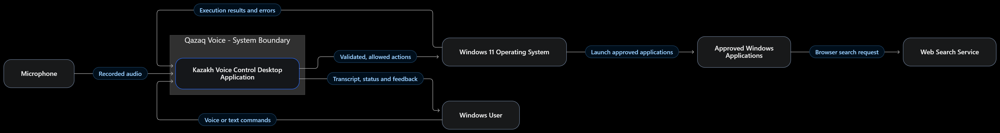
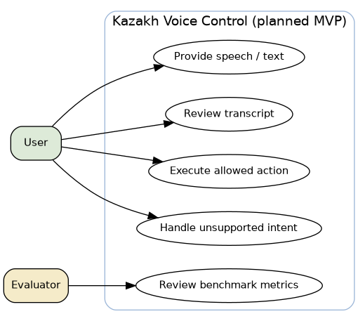
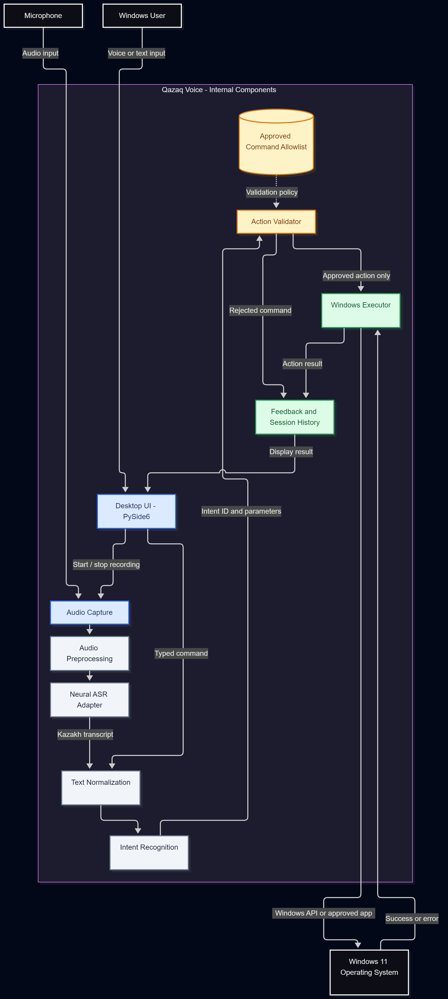
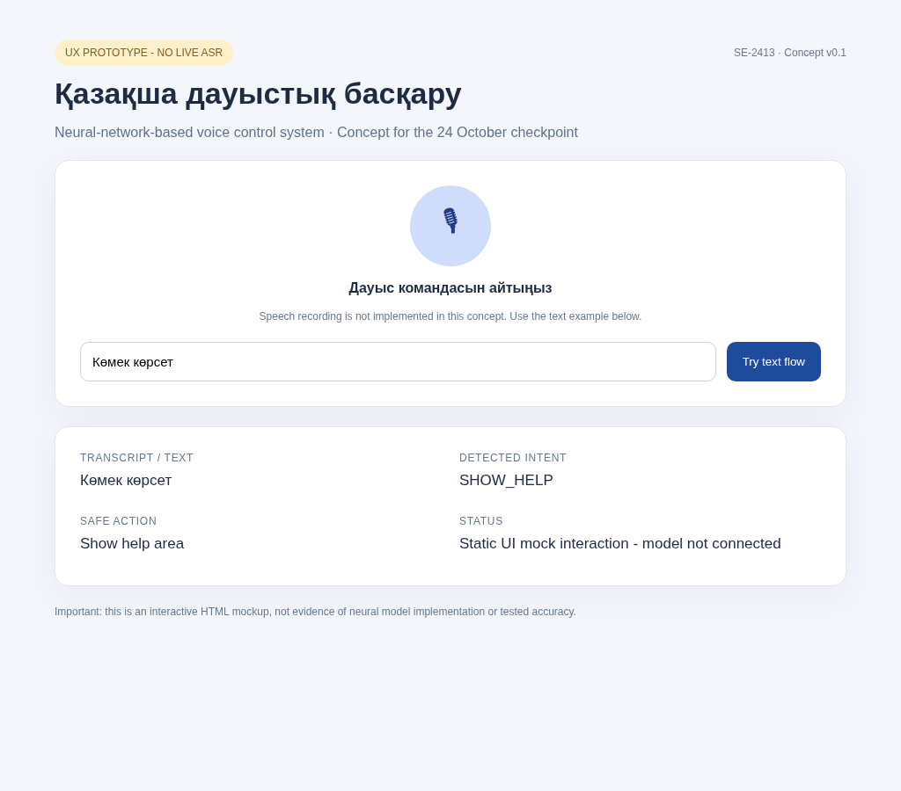
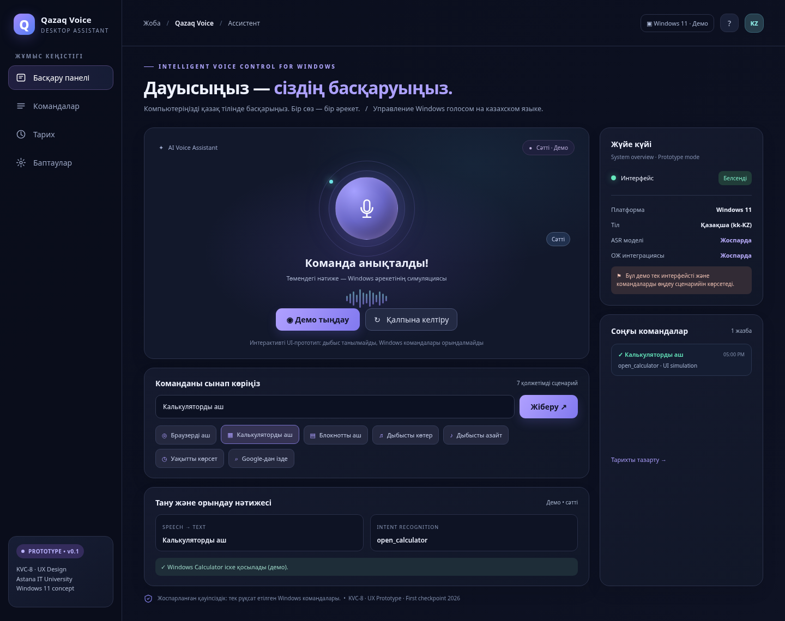
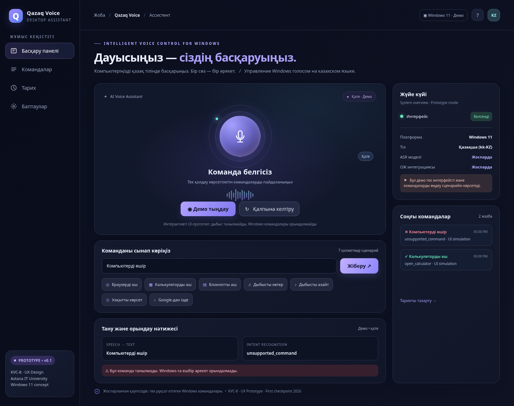

# Qazaq Voice — Kazakh Voice Control System

**Diploma Project:** Development of an Intelligent Voice Control System in the Kazakh Language Based on Neural Networks

**University:** Astana IT University  
**Program:** Software Engineering  
**Group:** SE-2413  
**Target Platform:** Windows 11  
**Project Stage:** First Checkpoint — Research, Design and UX Prototyping

## Overview

**Qazaq Voice** is a proposed intelligent voice assistant designed to enable users to interact with Windows 11 through Kazakh-language voice commands.

The project focuses on combining neural automatic speech recognition (ASR), natural-language command interpretation, and safe operating-system integration.

The intended system will recognize spoken Kazakh commands, identify predefined user intents, validate requested actions, and execute approved Windows operations.

The project also explores potential accessibility benefits for users who may prefer alternative methods of computer interaction.

## Project Objectives

- Investigate neural speech recognition approaches suitable for Kazakh.
- Design a Windows desktop voice assistant with a clear user interface.
- Recognize and classify a limited set of Kazakh commands.
- Validate commands before executing operating-system actions.
- Provide understandable feedback and error handling.
- Support manual text input as an alternative to voice commands.
- Evaluate recognition accuracy, execution reliability, latency, and safety.

## Planned Voice Commands

The initial MVP scope contains seven supported intents.

| Intent | Kazakh Example | Intended Function |
|---|---|---|
| `open_browser` | Браузерді аш | Open the default web browser |
| `open_calculator` | Калькуляторды аш | Launch Windows Calculator |
| `open_notepad` | Блокнотты аш | Launch Notepad |
| `volume_up` | Дыбысты көтер | Increase system volume |
| `volume_down` | Дыбысты азайт | Decrease system volume |
| `show_time` | Уақытты көрсет | Display the current time |
| `web_search` | Google-дан Астананы ізде | Search the web for a specified query |

Requests outside the approved command set are intended to be rejected safely.

## Proposed System Architecture

The planned processing pipeline is:

**Microphone → Audio Preprocessing → Neural ASR → Text Normalization → Intent Recognition → Action Validation → Windows Execution → User Feedback**

Text input will bypass microphone capture and ASR while using the same command interpretation and validation components.

### Architecture Diagrams

**System Context Diagram**

**Use Case Diagram**

**Component Diagram**

Editable Mermaid diagram sources are available in the [`diagrams/`](diagrams/) directory.

## Technologies

| Area | Technology or Approach | Status |
|---|---|---|
| Target operating system | Windows 11 | Selected target platform |
| Neural speech recognition | Whisper, XLS-R and other candidates | Under evaluation |
| Main development language | Python | Proposed |
| Desktop interface | PySide6 | Proposed |
| Intent recognition | Rule-based MVP, with possible ML extensions | Proposed |
| Windows integration | Allowlisted Windows APIs and approved application launching | Planned |
| UX prototype | HTML, CSS, JavaScript | Interactive demonstration available |
| Architecture diagrams | Mermaid | Prepared |
| Version control | Git and GitHub | Project repository |
| Task management | YouTrack | Project board |

## Current Implementation Status

The first checkpoint includes:

- Project proposal and scope.
- Preliminary user needs assessment.
- Literature review and source matrix.
- Comparison of existing voice-control systems.
- Technology comparison.
- Functional and non-functional requirements.
- System architecture and diagrams.
- Interactive UX prototype.
- Verification and evaluation plan.
- Project management and risk analysis.
- Supervisor consultation summary.

**Important:** The current browser-based prototype simulates speech interaction and Windows command results. It does not perform real microphone recording, neural ASR inference, or Windows command execution.

These functions are planned for subsequent development stages.

## UX Prototype

The interactive UX demonstration is located at:

[`prototype/index.html`](prototype/index.html)

To run:

1. Download or clone this repository.
2. Open `prototype/index.html` in a browser.
3. Choose a Kazakh command example or enter a command manually.
4. Observe the simulated processing, success, and error states.

On Windows, `prototype/LAUNCH_WINDOWS_WINDOW.bat` can optionally launch the prototype in an application-style browser window.

### Prototype Screenshots

The screenshots show simulated UX interactions, not confirmed Windows actions.

## Documentation

The documentation is organized into eleven first-checkpoint tasks.

| Task | Document |
|---|---|
| KVC-1 — Project Proposal | [Project Proposal](docs/KVC-01_PROJECT_PROPOSAL.md) |
| KVC-2 — Project Relevance | [Relevance Evidence](docs/KVC-02_RELEVANCE_EVIDENCE.md) |
| KVC-3 — Literature Review | [Critical Literature Review](docs/KVC-03_CRITICAL_LITERATURE_REVIEW.md) |
| KVC-4 — Existing Systems | [Existing System Comparison](docs/KVC-04_EXISTING_SYSTEM_COMPARISON.md) |
| KVC-5 — Technologies | [Technology Comparison](docs/KVC-05_TECHNOLOGY_COMPARISON.md) |
| KVC-6 — Requirements | [Requirements Specification](docs/KVC-06_REQUIREMENTS_SPECIFICATION.md) |
| KVC-7 — Architecture | [System Architecture](docs/KVC-07_ARCHITECTURE.md) |
| KVC-8 — UX Prototype | [UX Prototype Documentation](docs/KVC-08_UX_PROTOTYPE.md) |
| KVC-9 — Evaluation | [Verification and Evaluation Plan](docs/KVC-09_VERIFICATION_PLAN.md) |
| KVC-10 — Management | [Project Management and Risks](docs/KVC-10_PROJECT_MANAGEMENT_RISKS.md) |
| KVC-11 — Supervisor Feedback | [Supervisor Consultation and Feedback](docs/KVC-11_SUPERVISOR_FEEDBACK.md) |

**Literature Matrix:** [`docs/literature_matrix.xlsx`](docs/literature_matrix.xlsx)

**UX Evidence:** [`docs/KVC8_UX_PROTOTYPE_EVIDENCE.md`](docs/KVC8_UX_PROTOTYPE_EVIDENCE.md)

### First Checkpoint Report

- [Final Report — PDF](Qazaq_Voice_First_Checkpoint_Report_Condensed.pdf)
- [Final Report — DOCX](Qazaq_Voice_First_Checkpoint_Report_Condensed.docx)
- [Final Report — Markdown](Qazaq_Voice_First_Checkpoint_Report_Condensed.md)

These links refer to the consolidated report files included in the repository submission.

## Project Team

| Team Member | Planned Responsibility |
|---|---|
| Temirgali Nurislam Kairatuly | Project coordination, technical analysis, requirements, architecture, and project management |
| Myrzatay Alan Abayuly | User research, scientific literature, and existing-system analysis |
| Abdigali Nurassyl Zhandosuly | UX prototyping, evaluation planning, and supervisor feedback documentation |

**Scientific Supervisor:** Turarova Marzhan Kabdikalievna

Responsibilities describe the project work allocation. Actual contributions should be supported by repository history and review records.

## Project Management

**GitHub:** https://github.com/NurTem06/kazakh-voice-control-system

**YouTrack Project:** https://kazakh-voice-control.youtrack.cloud/projects/KVC

**Kanban Board:** https://kazakh-voice-control.youtrack.cloud/agiles/204-1/current

The checkpoint is organized into eleven tracked tasks, KVC-1 through KVC-11.

## Next Development Steps

1. Evaluate and select a Kazakh-compatible neural ASR model.
2. Build the Windows desktop application.
3. Implement microphone recording and preprocessing.
4. Integrate speech recognition with intent classification.
5. Implement and test an allowlisted Windows command executor.
6. Perform end-to-end recognition and command execution tests.
7. Measure WER, CER, intent accuracy, task success, and latency.
8. Improve usability, security, and accessibility based on evaluation results.

## Academic Status

This repository contains research, design documentation, a UX demonstration, and planning materials for the first diploma checkpoint.

It should not be interpreted as a completed or experimentally validated intelligent voice assistant.

**Institution:** Astana IT University  
**Checkpoint Date:** 24 October 2026
